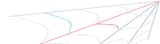
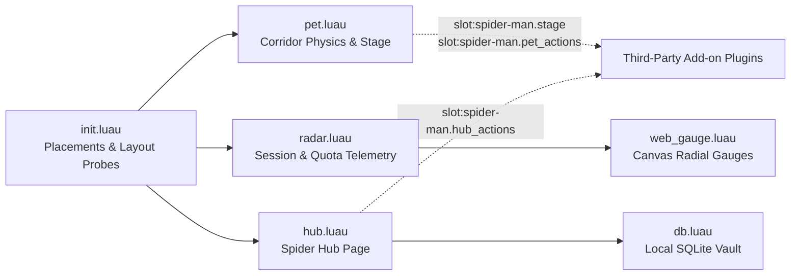

<div align="center">


<br />


# 🕷️ Zeron Spider-Man

**Spider-Verse Atmosphere · Spider-Sense Session & Quota Radar · Smart Desktop Patrol Pet · Local Web Vault**

[](https://github.com/yizixu/zeron-spider-man)
[](https://luau.org/)
[](#-languages)
[](./LICENSE)

**English** | [简体中文](./README.zh-CN.md)

</div>

---

> *"Anyone can wear the mask. Anyone can ship."*  
> Turn **Zeron** into your friendly neighborhood command center — complete with a live **3D parallax NYC skyline**, a **Spider-Sense radar** watching every background session and API quota window, **smart text-aware roaming spiders** that steer clear of reading columns, and an offline **SQLite Web Vault** for your best prompts.

---

## ✨ What Makes It Special

<table>
  <tr>
    <td width="50%" valign="top">
      <h3>🕸️ 1. Living Desktop Spider Companions</h3>
      <p>Animated multi-spider buddies patrol your workspace edges, spin translucent corner webs, rappel down on silk threads, and mirror live Zeron sessions.</p>
      <ul>
        <li>🧭 <b>Layout-Aware Corridor Patrol</b> — Dynamically measures sidebar &amp; centered composer bounds, steering spiders toward outer margins and window edges.</li>
        <li>👻 <b>Auto Ghost Transparency</b> — Spiders, spun webs, and whisper bubbles fade smoothly when passing over text zones, and snap back to <code>100%</code> on hover.</li>
        <li>⚡ <b>Live Session Binding</b> — Dedicated spiders track active/attention-needed sessions; completed turns trigger a celebratory <code>THWIP!</code> swing-out.</li>
      </ul>
    </td>
    <td width="50%" valign="top">
      <h3>📡 2. Spider-Sense Radar &amp; Quota Gauges</h3>
      <p>Never miss a stalled background agent or hit an unexpected rate-limit wall again.</p>
      <ul>
        <li>🚨 <b>Live Session Telemetry</b> — Monitors running, waiting-for-approval, and errored chats with one-click jump.</li>
        <li>🕸️ <b>Spider-Web Radial Gauges</b> — Custom <code>ink.canvas</code> radial web meters for Session / Daily / Weekly quota windows with configurable warning thresholds.</li>
        <li>🔔 <b>Smart Desktop Alerts</b> — Optional OS notifications when sessions need input, finish, error, or quota dips below threshold.</li>
      </ul>
    </td>
  </tr>
  <tr>
    <td width="50%" valign="top">
      <h3>🌆 3. Spider-Verse 3D Parallax Skyline</h3>
      <p>Transform Zeron's New Chat canvas into a layered New York nightscape with foreground spiderwebs.</p>
      <ul>
        <li>🖱️ <b>Configurable 3D Depth</b> — Choose <code>Off</code>, <code>Subtle</code>, <code>Normal</code>, or <code>Deep</code> cursor parallax.</li>
        <li>🎨 <b>Original WebP Artwork</b> — Skyline backdrop, dangling spiders, Spider-Crest watermark, and corner web filigree.</li>
      </ul>
    </td>
    <td width="50%" valign="top">
      <h3>💾 4. Local SQLite Web Vault &amp; Quick Prompts</h3>
      <p>Catch great AI replies and reusable prompts directly into your personal Spider-Web.</p>
      <ul>
        <li>📌 <b>One-Click "Save to Web"</b> — Hover any message to archive snippets right into local SQLite.</li>
        <li>⚡ <b>Composer Quick-Launch Bar</b> — Insert favorite prompt templates directly into the message box with one click.</li>
        <li>🔌 <b>Open Extension Slots</b> — Exposes <code>stage</code>, <code>pet_actions</code>, and <code>hub_actions</code> for ecosystem add-on plugins.</li>
      </ul>
    </td>
  </tr>
</table>

---

## 🎨 Built-in Artwork (`art/`)

All visuals shown below are the **actual built-in assets** shipped inside the plugin (no external mockups):

| NYC Night Skyline | Spider Crest | Dangling Patrol Spider | Foreground Web Filigree |
| :---: | :---: | :---: | :---: |
|  |  |  |  |

| Left Corner Web | Right Corner Web | Titlebar Hanging Spider | Plugin Icon (`icon.svg`) |
| :---: | :---: | :---: | :---: |
|  |  |  |  |

---

## 🚀 Installation

### Option A: One-Click `.zeron-plugin` Install (Recommended)
1. Download `spider-man-1.1.1.zeron-plugin` from the [**Latest Release**](https://github.com/yizixu/zeron-spider-man/releases/latest).
2. In **Zeron**, go to **Settings → Plugins → Install from file** (or drag-and-drop / use `install_plugin`).
3. Enable **Spider-Man**, and optionally set the **Spider-Verse Skyline** wallpaper in plugin settings.

### Option B: Install from Source (Developer Mode)
Clone this repository into Zeron's local plugins directory:

- **Windows**: `%LOCALAPPDATA%\Zeron\plugins\spider-man`
- **macOS**: `~/Library/Application Support/Zeron/plugins/spider-man`
- **Linux**: `~/.local/share/Zeron/plugins/spider-man`

```bash
git clone https://github.com/yizixu/zeron-spider-man.git spider-man
```

Zeron will automatically validate, sign, and hot-reload the plugin.

---

## ⚙️ Settings & Customization

| Setting | Type | Default | Description |
| :--- | :--- | :--- | :--- |
| 🖼️ **New-chat wallpaper** | Wallpaper | Host toggle (off by default) | Toggle Spider-Verse NYC skyline on the new-chat screen |
| 🌀 **3D Parallax depth** | `off` / `subtle` / `normal` / `deep` | `normal` | Cursor-tracking depth for skyline and foreground webs |
| 🔔 **Spider-Sense notifications** | Switch | `true` | OS alerts for waiting, errored, finished chats, and low quota |
| 🚨 **Quota alert threshold** | `10%` / `15%` / `25%` / `35%` | `15%` | Triggers crimson Spider-Sense alert below threshold |
| ⚡ **Web toolbar** | Switch | `true` | Prompts, quick notes and web accents beneath the composer |
| 📌 **Save message to Web button** | Switch | `true` | Hover button on chat messages to save to SQLite |
| 🕸️ **Sidebar spider elements** | Switch | `true` | Sidebar Spider-Net divider & dangling patrol spider |
| 🕷️ **Panel roaming spiders** | Switch | `true` | Animated multi-spider companions with layout-aware fading |

---

## 🧩 Architecture & Extension Slots

`zeron-spider-man` is written in modular **Luau** and stays **100% workflow-agnostic**:



```text
zeron-spider-man/
├── init.luau           # Plugin lifecycle, UI placements & layout probes
├── pet.luau            # Multi-spider physics, silk weaving, text-zone avoidance & stage_snapshot
├── hub.luau            # Spider Hub page (Radar tab + SQLite Web Snippets & Prompts tab)
├── radar.luau          # Session polling, usage quota aggregation & OS notification dispatcher
├── web_gauge.luau      # Custom ink.canvas radial spiderweb quota gauges & sparklines
├── db.luau             # Local SQLite persistence for prompts & snippets
├── art/                # Original .webp skyline, webs & spider mascots
└── locales/            # English (en.json) & Simplified Chinese (zh-Hans.json) i18n
```

### 🔌 Public Extension Slots (for Third-Party Add-ons)
Companion plugins can inject UI into `spider-man` using `zeron.place`:

| Slot Selector | Purpose | Shared Props Received |
| :--- | :--- | :--- |
| `slot:spider-man.stage` | Render extra overlay actors/effects on the window stage | `spider_stage` (`w`, `h_up`, `zones`, `webs`, `pets`) |
| `slot:spider-man.pet_actions` | Add custom action buttons inside the spider popover menu | `slot` / active session context |
| `slot:spider-man.hub_actions` | Add toolbar actions inside Spider Hub | Hub page state |

---

## 🔐 Permissions Used

Every permission declared in [`zeron-plugin.json`](./zeron-plugin.json) maps directly to a visible feature:
- `ui.add` / `ui.change` — Sidebar badge, composer quick-bar, wallpaper, and transparent pet stage
- `pages.add` / `navigate` — **Spider Hub** page and jumping directly to sessions
- `sessions.read` / `messages.read` / `usage.read` — Live task & quota monitoring + saving replies
- `compose` / `notifications` — Inserting quick prompts & sending Spider-Sense alerts

---

## 🌐 Languages

- [🇺🇸 English (README.md)](./README.md)
- [🇨🇳 简体中文 (README.zh-CN.md)](./README.zh-CN.md)

---

<div align="center">

Made with 🕸️ for **Zeron** · MIT License © 2026 [yizixu](https://github.com/yizixu)

</div>

## Web Notes

Click **Quick note** in the web toolbar beneath the composer to capture an idea without leaving the conversation. Drafts are kept automatically; Ctrl+Enter saves. Notes link to the current conversation and project. **Keep as note** on a message captures its text and source.

Click **Quick notes** in the web toolbar to search saved notes and insert one into the current draft in one step. Choose **New note** from the same picker to capture a fresh thought. Use **Spider Hub → Notes** when you need to search, edit, delete, or inspect sources. Notes live in the local plugin SQLite database, separate from saved prompts and snippets.
