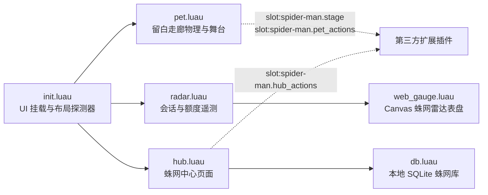

<div align="center">


<br />


# 🕷️ Zeron Spider-Man（蜘蛛侠）

**纵横宇宙暗夜美学 · 「蜘蛛感应」任务与额度雷达 · 智能避让桌面蜘蛛伙伴 · 本地蛛网提示词库**

[](https://github.com/yizixu/zeron-spider-man)
[](https://luau.org/)
[](#-多语言文档)
[](./LICENSE)

[English](./README.md) | **简体中文**

</div>

---

> *“能力越大，代码越稳。任何人都可以戴上面具，任何人都能上线发布。”*  
> 为 **Zeron** 注入满满的蜘蛛侠纵横宇宙氛围：暗夜纽约 3D 视差天际线、实时盯梢后台会话与账号余量的 **蜘蛛感应雷达**、**懂得绕开文字区并自动幽灵半透明的桌面小蜘蛛**，以及离线 **SQLite 蛛网收藏与快捷指令中心**。

---

## ✨ 核心亮点

<table>
  <tr>
    <td width="50%" valign="top">
      <h3>🕸️ 1. 灵动且懂分寸的桌面小蜘蛛</h3>
      <p>多只小蜘蛛会在窗口四周巡逻、在角落织出半透明蛛网、垂丝降落，并与你的实时 AI 会话绑定互动。</p>
      <ul>
        <li>🧭 <b>动态识别阅读区与留白走廊</b> — 实时探测侧边栏边界与居中阅读/输入列，优先在两侧留白走廊与窗口边缘活动。</li>
        <li>👻 <b>经过文字区自动半透明避让</b> — 蜘蛛、织网与气泡进入阅读区或侧边栏文字区时自动淡化，鼠标悬停即刻恢复 <code>100%</code> 清晰交互。</li>
        <li>⚡ <b>会话状态联动</b> — 后台任务等待确认时亮红提醒，任务完成还会触发炫酷的 <code>THWIP!</code> 荡丝离场动画。</li>
      </ul>
    </td>
    <td width="50%" valign="top">
      <h3>📡 2. 蜘蛛感应雷达 &amp; 蛛网额度仪表盘</h3>
      <p>再也不用担心后台 Agent 卡在审批环节，或者写到一半突然额度见底。</p>
      <ul>
        <li>🚨 <b>全窗口会话态势感知</b> — 实时聚合运行中、待确认、报错会话，点击胶囊或卡片一键直达对应对话。</li>
        <li>🕸️ <b>Canvas 手绘蛛网雷达表盘</b> — 为 Session / Daily / Weekly 额度窗口绘制脉冲蛛网环形图，支持自定义警戒百分比。</li>
        <li>🔔 <b>智能系统通知</b> — 任务待输入、报错、完成或额度低于警戒线时自动推送系统通知。</li>
      </ul>
    </td>
  </tr>
  <tr>
    <td width="50%" valign="top">
      <h3>🌆 3. 纵横宇宙 3D 视差纽约天际线</h3>
      <p>将 Zeron 的新对话主页化身为层次分明的暗夜纽约摩天楼天际线与前景蛛网。</p>
      <ul>
        <li>🖱️ <b>四档视差深度</b> — 支持 <code>关闭</code>、<code>轻微</code>、<code>标准</code>、<code>深邃</code> 鼠标跟随视差。</li>
        <li>🎨 <b>全套内置原画素材</b> — 天际线壁纸、倒挂小蜘蛛、蜘蛛徽章水印与角落蛛丝纹理。</li>
      </ul>
    </td>
    <td width="50%" valign="top">
      <h3>💾 4. 本地 SQLite 蛛网库 &amp; 一键填词</h3>
      <p>把好用的 Prompt 模板与高价值 AI 回复随手“粘”进本地蛛网库。</p>
      <ul>
        <li>📌 <b>消息一键「存到蛛网」</b> — 鼠标悬停任意对话气泡即可收藏至本地 SQLite 数据库。</li>
        <li>⚡ <b>输入框快捷指令条</b> — 在输入框下方一键切换并填入常用提示词模板。</li>
        <li>🔌 <b>开放扩展插槽</b> — 暴露 <code>stage</code>、<code>pet_actions</code>、<code>hub_actions</code>，方便生态扩展插件接入联动。</li>
      </ul>
    </td>
  </tr>
</table>

---

## 🎨 内置原画资源一览（`art/`）

以下均是插件实际内置并渲染的原画素材（无任何虚构效果图）：

| 暗夜纽约天际线 | 蜘蛛徽章 | 倒挂巡逻小蜘蛛 | 前景蛛网纹理 |
| :---: | :---: | :---: | :---: |
|  |  |  |  |

| 左侧蛛网 | 右侧蛛网 | 顶栏垂丝小蜘蛛 | 插件图标（`icon.svg`） |
| :---: | :---: | :---: | :---: |
|  |  |  |  |

---

## 🚀 安装方式

### 方式一：下载 `.zeron-plugin` 一键安装（推荐）
1. 前往 [**Releases 页面**](https://github.com/yizixu/zeron-spider-man/releases/latest) 下载 `spider-man-1.1.1.zeron-plugin`。
2. 在 **Zeron** 中打开 **设置 → 插件 → 从文件安装**（或直接拖入 / 调用 `install_plugin`）。
3. 启用 **蜘蛛侠（Spider-Man）**，并可在插件设置中一键启用新对话壁纸与各类开关。

### 方式二：源码安装（开发者模式）
将本仓库克隆到 Zeron 的本地插件目录：

- **Windows**：`%LOCALAPPDATA%\Zeron\plugins\spider-man`
- **macOS**：`~/Library/Application Support/Zeron/plugins/spider-man`
- **Linux**：`~/.local/share/Zeron/plugins/spider-man`

```bash
git clone https://github.com/yizixu/zeron-spider-man.git spider-man
```

Zeron 会自动完成签名校验并热重载插件。

---

## ⚙️ 插件设置项说明

| 设置项 | 类型 | 默认值 | 说明 |
| :--- | :--- | :--- | :--- |
| 🖼️ **新对话壁纸** | 壁纸开关 | 宿主选择（默认未开启） | 将暗夜纽约天际线设为新对话背景 |
| 🌀 **3D 视差深度** | `off` / `subtle` / `normal` / `deep` | `normal` | 城市天际线与前景蛛网随鼠标移动的幅度 |
| 🔔 **蜘蛛感应系统通知** | 开关 | `true` | 会话待确认、报错、完成或低额度时发送系统通知 |
| 🚨 **额度警戒线** | `10%` / `15%` / `25%` / `35%` | `15%` | 账号剩余额度低于该比例时触发红色警戒 |
| ⚡ **蛛网快捷栏** | 开关 | `true` | 在输入框下方显示快捷指令、随手记与蛛网装饰 |
| 📌 **消息「存到蛛网」按钮** | 开关 | `true` | 悬停对话消息时显示一键收藏到蛛网按钮 |
| 🕸️ **左侧边栏蜘蛛装饰** | 开关 | `true` | 左侧边栏顶部分隔条与底部倒挂巡逻小蜘蛛 |
| 🕷️ **面板漫游小蜘蛛** | 开关 | `true` | 在窗口上放养多只可互动、会自动避让文字的小蜘蛛伙伴 |

---

## 🧩 项目架构与开放扩展插槽

`zeron-spider-man` 采用纯模块化 **Luau** 编写，**100% 通用无特定业务耦合**：



```text
zeron-spider-man/
├── init.luau           # 插件入口、UI 挂载点与窗口布局区域探测器
├── pet.luau            # 多蜘蛛运动物理、织网、文字区避让与 stage_snapshot 状态共享
├── hub.luau            # 「蛛网中心」页面（蜘蛛感应雷达 + SQLite 蛛网收藏与快捷指令）
├── radar.luau          # 会话轮询、用量额度聚合与系统通知分发器
├── web_gauge.luau      # 基于 ink.canvas 手绘的蛛网环形额度雷达与折线图
├── db.luau             # 本地 SQLite 持久化层（spider_snippets）
├── art/                # .webp 天际线、蛛网与小蜘蛛原画资源
└── locales/            # 完整简体中文（zh-Hans.json）与英文（en.json）多语言包
```

### 🔌 开放扩展插槽（供生态插件扩展）
第三方配套插件可通过 `zeron.place` 挂载到以下插槽：

| 插槽选择器 | 用途 | 传入的共享上下文 |
| :--- | :--- | :--- |
| `slot:spider-man.stage` | 在主舞台透明层叠加额外互动元素或粒子 | `spider_stage`（含 `w`、`h_up`、`zones`、`webs`、`pets`） |
| `slot:spider-man.pet_actions` | 在点击小蜘蛛弹出的卡片中添加自定义快捷按钮 | 当前蜘蛛槽位与会话上下文 |
| `slot:spider-man.hub_actions` | 在「蛛网中心」顶部操作区扩展工具按钮 | 蛛网中心页面状态 |

---

## 🔐 权限说明

[`zeron-plugin.json`](./zeron-plugin.json) 中声明的每项权限均直接对应上述功能：
- `ui.add` / `ui.change` — 侧边栏胶囊、输入框快捷条、新对话壁纸与透明小蜘蛛舞台
- `pages.add` / `navigate` — 「蛛网中心」独立页面与点击一键跳转对应会话
- `sessions.read` / `messages.read` / `usage.read` — 任务状态与额度监控、消息收藏入库
- `compose` / `notifications` — 快捷指令一键填入与蜘蛛感应桌面通知

---

## 🌐 多语言文档

- [🇺🇸 English (README.md)](./README.md)
- [🇨🇳 简体中文 (README.zh-CN.md)](./README.zh-CN.md)

---

<div align="center">

Made with 🕸️ for **Zeron** · MIT License © 2026 [yizixu](https://github.com/yizixu)

</div>

## 蛛丝随手记

在输入框下方蛛网快捷栏点击「随手记」，不离开当前对话就能捕捉灵感；草稿自动保留，Ctrl+Enter 保存。笔记关联当前会话和项目，消息操作中的「记下这条」还能保存整条消息及来源。

点击输入框下方快捷栏的「随手记」即可搜索已保存笔记，并一步填入当前草稿；在列表底部选择「新建笔记」可直接记录新想法。「蛛网中心 → 随手记」用于搜索、编辑、删除和查看来源。笔记保存在本机插件 SQLite 数据库中，独立于 Prompt 与消息收藏。
